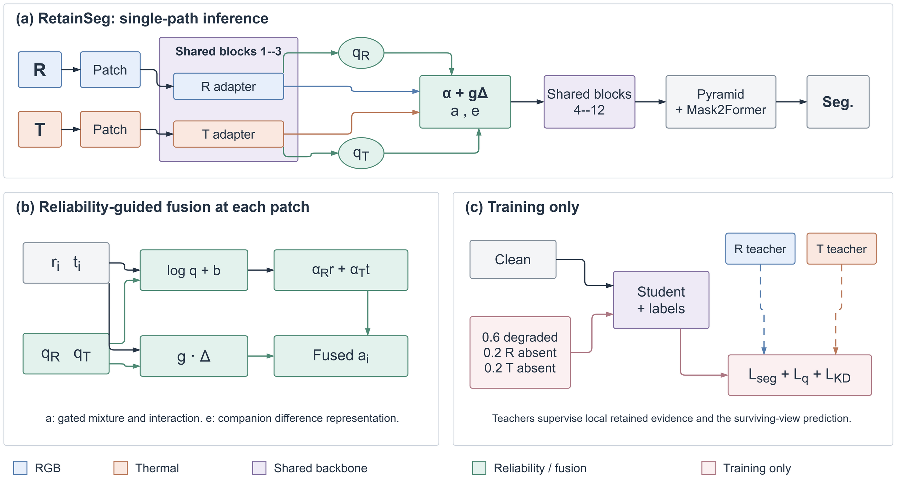
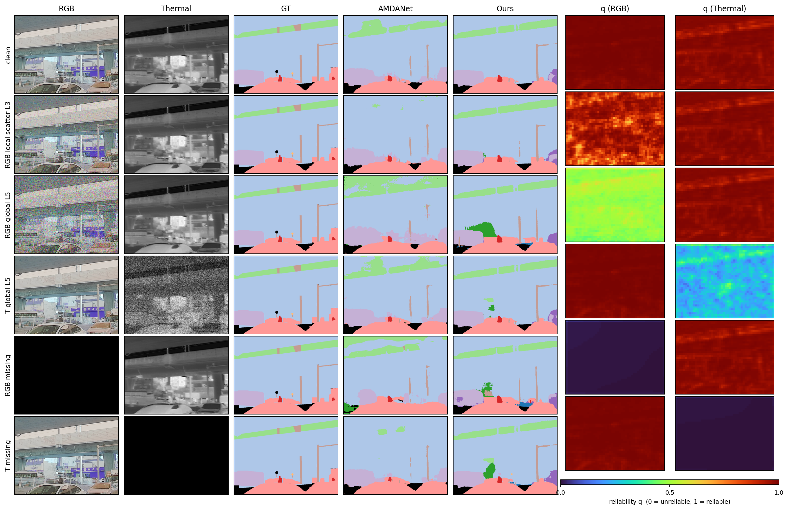

# RetainSeg

**RGB-T semantic segmentation that keeps working when a sensor stops.**

<p align="center">
  
</p>

RGB-Thermal segmentation fuses a visible camera with a thermal camera. In the field the two
sensors are rarely equally useful: thermal carries the scene at night, RGB carries it in
daylight, and either one can degrade, blur, or fail outright. Most fusion networks are
trained as if both streams are always healthy, so they collapse when one of them is not.

RetainSeg treats **modality availability as a learned quantity**. A per-modality reliability
head estimates how much each sensor can be trusted *from that sensor alone*, that estimate
drives a convex anchor fusion, and explicit whole-modality-missing views during training turn
the estimate into a hard capability: lose a sensor, keep the segmentation.

---

## The idea, in three pieces

**1 · Reliability is estimated per modality, never from the pair.**
The reliability head reads one modality's shallow tokens plus that modality's own global
statistic. It cannot borrow evidence from the other sensor, which is exactly why a deleted
sensor scores itself as deleted — measured `q` drops from `0.998` on clean input to `0.057`
when RGB is zeroed, while the thermal head stays at `0.993`.

**2 · The anchor is a convex mixture of the two token streams.**
Because the mixing weights come from `softmax(log q + b)`, `q → 0` makes the anchor *exactly*
the surviving modality. Whole-modality failure therefore degrades the network to a clean
single-modality segmenter by construction, not by luck.

**3 · Missing views and unimodal distillation make that capability real.**
Training samples 60% corrupted views, 20% RGB-missing views and 20% thermal-missing views.
On a missing view the model is distilled from the *matching* single-modality teacher, so the
missing direction has an explicit target instead of an implicit one.

---

## Results

Protocol (**RGBT-C v4**, implemented in `tools/bench_v4.py`): severity {2, 3, 5} × scope
{global, scatter} × pool {in-distribution, held-out}, one operator sampled per cell with a
deterministic seed — 15 cases per image, plus `clean` and the two whole-modality-missing
cases. Every method sees identical degraded pixels.

| Dataset | Method | clean | degradation (ID) | OOD | **missing RGB** | missing T |
|---|---|---:|---:|---:|---:|---:|
| PST900 | **RetainSeg** | 86.54 | 82.14 | 84.11 | **57.45** | 83.96 |
| PST900 | AMDANet | 87.15 | 83.31 | 83.84 | 25.75 | 84.59 |
| PST900 | PEAFusion | **89.63** | 83.09 | **88.93** | 19.44 | **89.49** |
| MFNet | **RetainSeg** | 62.01 | 60.09 | **60.95** | **55.92** | **57.99** |
| MFNet | AMDANet | **62.88** | **60.75** | 60.66 | 53.92 | 57.83 |
| MFNet | PEAFusion | 61.01 | 54.07 | 57.33 | 40.47 | 53.81 |
| FMB | **RetainSeg** | **75.45** | **73.65** | **73.85** | **67.59** | **72.63** |
| FMB | AMDANet | 69.78 | 66.50 | 63.48 | 53.27 | 64.31 |
| FMB | PEAFusion | 69.87 | 59.23 | 58.76 | 11.62 | 58.16 |

### How much of a single-modality model survives

`rho = mIoU(modality removed) / mIoU(dedicated single-modality model)`

| Dataset | rho (no RGB) | rho (no thermal) |
|---|---:|---:|
| PST900 | **97.6 %** | **97.9 %** |
| MFNet | **97.0 %** | **97.1 %** |
| FMB | **108.0 %** | **99.0 %** |

Five of six directions land at 97–99%; on FMB, losing RGB costs nothing at all — the model
actually beats the thermal-only teacher, because the fusion still pulls structure out of the
surviving stream that a purely thermal network cannot reach.

Full tables, per-cell breakdown and the evaluation caveats: [`docs/RESULTS.md`](docs/RESULTS.md).

---

## Qualitative results



*FMB — rows: clean / RGB-local / RGB-global / T-global / RGB-missing / T-missing. Columns:
RGB, thermal, ground truth, AMDANet, RetainSeg, and the predicted reliability `q` of each
modality. `q` falls exactly where a modality is damaged and recovers when it is intact.*

More panels (PST900, MFNet, reliability diagnostic) in
[`assets/figures/`](assets/figures).

---

## Quick start

### Install

```bash
conda create -n retainseg python=3.10 -y && conda activate retainseg
pip install torch==2.2.2 torchvision==0.17.2 --index-url https://download.pytorch.org/whl/cu121
pip install mmcv==2.2.0 -f https://download.openmmlab.com/mmcv/dist/cu121/torch2.2/index.html
pip install -r requirements.txt
pip install -e .
```

> `mmdet 3.3.0` asserts `mmcv < 2.2`. With `mmcv 2.2.x` that check fires even though the
> few mmdet utilities used here are compatible — install `mmcv 2.1.x`, or relax the
> assertion in `site-packages/mmdet/__init__.py`.

The DINOv3 backbone is loaded through `transformers` (≥ 4.56):

```bash
huggingface-cli download facebook/dinov3-vitb16-pretrain-lvd1689m \
    --local-dir pretrain/dinov3-vitb16
```

### Data

```
data/PST900_RGBT_Dataset/{train,test}/{rgb,thermal,labels}/*.png
data/MFNet/{images,labels}/*.png              + train.txt / test.txt
data/FMB_ALL/FMB/{images/training,images/validation,annotations/...}
data/FMB_ALL/FMB_T/images/{training,validation}/*.png     # thermal
```

| Dataset | classes | note |
|---|---|---|
| PST900 | 5 | background counted, as in the AMDANet / PEAFusion papers |
| MFNet | 9 | background counted |
| FMB | 13 | background and *Bicycle* excluded (`Bicycle` has zero pixels in the test split) |

### Train

```bash
# Stage 2A — clean dense baseline
python tools/train.py configs/dino_ts/stage2a_full_dense_pst900.py --work-dir work_dirs/stage2a

# Stage 2R — reliability + missing views + unimodal distillation
python tools/train.py configs/dino_ts/stage2r_reliable_pst900.py \
    --work-dir work_dirs/stage2r \
    --cfg-options load_from=work_dirs/stage2a/best_mIoU_epoch_30.pth
```

`stage2r_reliable_{mfnet,fmb}.py` are the MFNet / FMB counterparts. Knobs that matter:
`lambda_q` (reliability supervision), `view_probs` (corrupt / RGB-missing / T-missing
mixture), and the `RGBTDegrader` block in the train pipeline (`degrade_prob`,
`modality_probs`, `scope_probs`, `severity_range`, `area_range`).

### Evaluate

```bash
python tools/bench_v4.py \
    --config configs/dino_ts/stage2r_reliable_pst900.py \
    --checkpoint weights/retainseg_pst900.pth \
    --levels 2,3,5 --scopes global,scatter --ood \
    --out results/pst900_v4.json
```

Single-modality reference numbers (the retention denominators):

```bash
python tools/teacher_clean.py \
    --config configs/dino_ts/baseline_thermal_only_pst900.py \
    --checkpoint weights/teacher_thermal_pst900.pth --num-classes 5 \
    --out results/pst900_thermal_teacher.json
```

`tools/baselines/` holds the matching evaluators for AMDANet and PEAFusion so every method
is measured on identical degraded pixels.

---

## Code map

| Path | What it is |
|---|---|
| `mmseg/models/backbones/dino_ts_reliable.py` | reliability head, convex fusion, interaction residual, channel gate |
| `mmseg/models/segmentors/dino_ts/stage2r_reliable.py` | Stage-2R segmentor: missing views, reliability loss, unimodal KD |
| `mmseg/models/segmentors/dino_ts/reliability_losses.py` | quality targets, reliability regression, distillation losses |
| `mmseg/models/backbones/dino_shared_vit.py` | shared ViT trunk, anchor / extra token construction |
| `mmseg/datasets/{pst900,mfnet,fmb}.py` | dataset definitions (class protocols above) |
| `rgbt_c/` | RGBT-C degradation library: protocol, operators, torch adapter |
| `configs/dino_ts/` | training configs for all datasets and ablations |
| `tools/bench_v4.py` | the v4 benchmark used for every number in this README |

## Weights

No checkpoints are shipped in this repository. See
[`weights/README.md`](weights/README.md) for the released files, their checksums and where
to place them.

## Citation

```bibtex
@misc{retainseg2026,
  title  = {RetainSeg: Reliability-Guided RGB-T Semantic Segmentation under
            Modality Degradation and Complete Modality Failure},
  author = {Liu, Fei},
  year   = {2026},
  url    = {https://github.com/fieliu/RetainSegRGBT}
}
```

## Acknowledgements

The segmentation framework is built on
[MMSegmentation](https://github.com/open-mmlab/mmsegmentation) (Apache-2.0) and the
[DINOv3](https://github.com/facebookresearch/dinov3) backbone. The corruption protocol
follows the spirit of [ImageNet-C](https://github.com/hendrycks/robustness) and
[RGBT-C](https://github.com/UkcheolShin/RGBT-C).

## License

Apache-2.0 — see [LICENSE](LICENSE).
