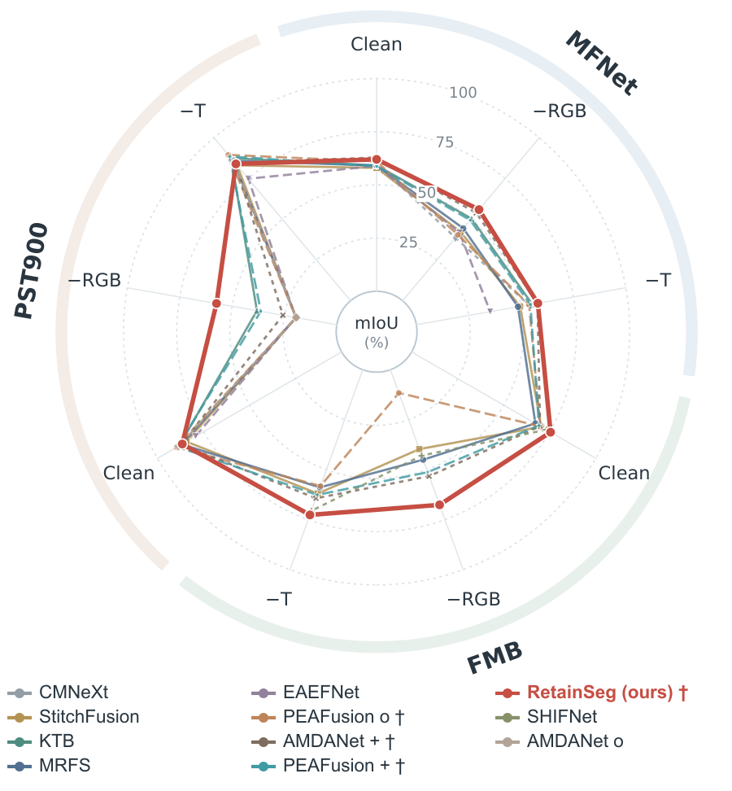
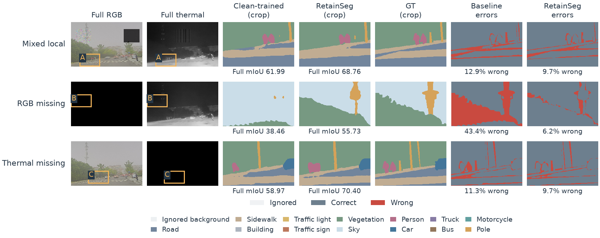
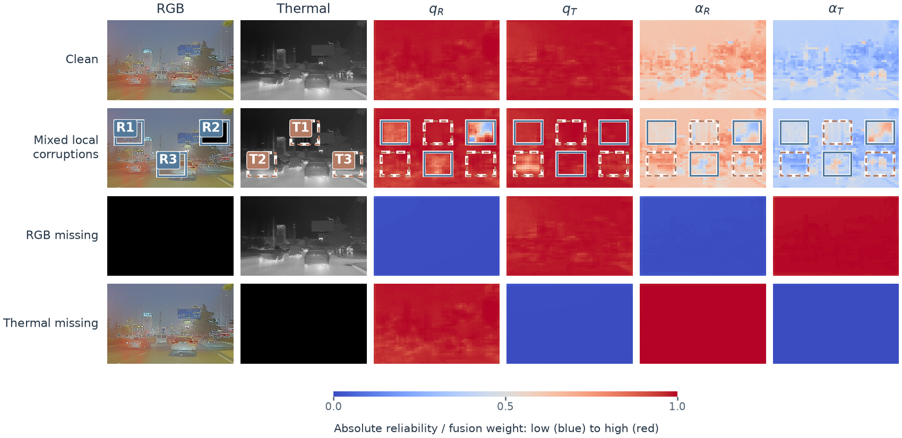

# RetainSeg

**RGB-T semantic segmentation that keeps working when a sensor stops.**

<p align="center">
  
</p>

RGB-Thermal segmentation fuses a visible camera with a thermal camera. In the field the two
sensors are rarely equally useful: thermal carries the scene at night, RGB carries it in
daylight, and either one can degrade, blur, or fail outright. Most fusion networks are trained
as if both streams are always healthy, so they collapse when one of them is not.

RetainSeg treats **modality availability as a learned quantity**. A per-modality reliability
head estimates how much each sensor can be trusted *from that sensor alone*, that estimate
drives a convex anchor fusion, and explicit whole-modality-missing views during training turn
the estimate into a hard capability: lose a sensor, keep the segmentation.

---

## The idea, in three pieces

**1 · Reliability is estimated per modality, never from the pair.**
The reliability head reads one modality's shallow tokens plus that modality's own global
statistic. It cannot borrow evidence from the other sensor, which is exactly why a deleted
sensor scores itself as deleted — measured `q` drops from `0.998` on clean input to `0.057`
when RGB is zeroed, while the thermal head stays at `0.993`.

**2 · The anchor is a convex mixture of the two token streams.**
Because the mixing weights come from `softmax(log q + b)`, `q → 0` makes the anchor *exactly*
the surviving modality. Whole-modality failure therefore degrades the network to a clean
single-modality segmenter by construction, not by luck.

**3 · Missing views and unimodal distillation make that capability real.**
Training samples 60% corrupted views, 20% RGB-missing views and 20% thermal-missing views.
On a missing view the model is distilled from the *matching* single-modality teacher, so the
missing direction has an explicit target instead of an implicit one.



---

## Results

Protocol (**RGBT-C**): severity {2, 3, 5} × spatial scope {global, scatter} × corruption pool
{in-distribution, held-out}, one operator sampled per cell with a deterministic seed — 15 cases
per image: 12 degraded cells plus `clean` and the two whole-modality-missing cases. Every method
sees identical degraded pixels. `ID`/`OOD` average the 15 in-distribution and the 6 held-out cases.

Retention `ρ` is what survives of a dedicated single-modality network:
`ρ−R = 100 · mIoU(RGB removed) / mIoU(thermal-only teacher)`,
`ρ−T = 100 · mIoU(thermal removed) / mIoU(RGB-only teacher)`.

### MFNet — 9 classes, 480×640, 393 test images

| Method | Clean | ID | OOD | RGB loss | ρ−R | T loss | ρ−T |
|---|---:|---:|---:|---:|---:|---:|---:|
| *Without corruption training* | | | | | | | |
| CMNeXt (CVPR 2023) | 60.10 | 54.72 | 56.77 | 38.65 | 67.0 | 53.71 | 90.0 |
| StitchFusion (ACM MM 2025) | 57.99 | 53.80 | 54.88 | 42.35 | 73.4 | 49.52 | 82.9 |
| Keep the Balance (CVPR 2025) | 59.14 | 55.04 | 55.89 | 50.43 | 87.4 | 55.30 | 92.6 |
| MRFS (CVPR 2024) | 59.06 | 54.26 | 53.57 | 44.41 | 77.0 | 48.51 | 81.2 |
| EAEFNet (RA-L 2023) | 58.94 | 48.53 | 47.99 | 41.72 | 72.3 | 35.23 | 59.0 |
| PEAFusion (Inf. Fusion 2025)† | 61.01 | 54.07 | 57.33 | 40.47 | 70.2 | 53.81 | 90.1 |
| *With RGBT-C corruption training* | | | | | | | |
| AMDANet (ICCV 2025)† | **62.88** | **60.75** | 60.66 | 53.92 | 93.5 | 57.83 | 96.8 |
| PEAFusion (Inf. Fusion 2025)† | 58.75 | 56.62 | 56.45 | 49.48 | 85.8 | 54.42 | 91.1 |
| **RetainSeg (ours)**† | 62.01 | 60.09 | **60.95** | **55.92** | **97.0** | **57.99** | **97.1** |
| *Single-modality references* | | | | | | | |
| Thermal-only teacher | — | — | — | 57.67 | 100.0 | — | — |
| RGB-only teacher | — | — | — | — | — | 59.71 | 100.0 |

† evaluation variant: PEAFusion replays corruption differently and filters excluded-class
predictions.

### PST900 — 5 classes, 288 test images

| Method | Clean | ID | OOD | RGB loss | ρ−R | T loss | ρ−T |
|---|---:|---:|---:|---:|---:|---:|---:|
| *Without corruption training* | | | | | | | |
| StitchFusion (ACM MM 2025) | 84.30 | 80.74 | 83.70 | 19.44 | 33.0 | 83.10 | 96.9 |
| Keep the Balance (CVPR 2025) | 88.14 | **84.54** | 87.12 | **38.15** | **64.8** | 87.48 | 102.0 |
| MRFS (CVPR 2024) | 86.87 | 80.74 | 83.92 | 19.44 | 33.0 | 85.90 | 100.2 |
| EAEFNet (RA-L 2023) | 79.34 | 68.92 | 71.01 | 19.64 | 33.4 | 74.87 | 87.3 |
| AMDANet (ICCV 2025) | 88.57 | 83.29 | 85.19 | 19.44 | 33.0 | 85.43 | 99.7 |
| PEAFusion (Inf. Fusion 2025)† | **89.63** | 83.09 | **88.93** | 19.44 | 33.0 | **89.49** | **104.4** |
| *With RGBT-C corruption training* | | | | | | | |
| AMDANet (ICCV 2025) | 87.15 | 83.30 | 83.83 | 25.75 | 43.8 | 84.59 | 98.7 |
| PEAFusion (Inf. Fusion 2025)† | **89.10** | **84.93** | **88.22** | 36.30 | 61.7 | **88.55** | **103.3** |
| **RetainSeg (ours)**† | 86.54 | 82.14 | 84.11 | **57.45** | **97.6** | 83.96 | 97.9 |
| *Single-modality references* | | | | | | | |
| Thermal-only teacher | — | — | — | 58.84 | 100.0 | — | — |
| RGB-only teacher | — | — | — | — | — | 85.73 | 100.0 |

Resolution note: every baseline row is evaluated at native **720×1280**; RetainSeg is evaluated
at **360×640**. Its clean accuracy is therefore *not* a like-for-like high-resolution claim —
the paper states this explicitly, and the RGB-loss column (where the two share scale) is the
honest comparison.

### FMB — 280 test images

| Method | Clean | ID | OOD | RGB loss | ρ−R | T loss | ρ−T |
|---|---:|---:|---:|---:|---:|---:|---:|
| *Without corruption training* (12-class profile) | | | | | | | |
| StitchFusion (ACM MM 2025) | 70.37 | 64.43 | 66.62 | 39.72 | 63.4 | 61.94 | 84.4 |
| MRFS (CVPR 2024) | 67.21 | 61.76 | 56.84 | 45.02 | 71.9 | 58.85 | 80.2 |
| SHIFNet (arXiv 2025) | 73.13 | 65.57 | 67.47 | 42.95 | 68.6 | 70.61 | 96.3 |
| PEAFusion (Inf. Fusion 2025)† | 69.87 | 59.23 | 58.76 | 11.62 | 18.6 | 58.16 | 79.3 |
| OGP-Net (AAAI 2025)‡ | — | — | — | 48.89 | 78.1 | — | — |
| OGP-Net-IR (AAAI 2025)‡ | — | — | — | 48.56 | 77.6 | — | — |
| *With RGBT-C corruption training* (13-class profile) | | | | | | | |
| AMDANet (ICCV 2025)† | 69.78 | 66.50 | 63.48 | 53.27 | 85.1 | 64.31 | 87.7 |
| PEAFusion (Inf. Fusion 2025)† | 69.17 | 64.78 | 62.24 | 51.25 | 81.9 | 62.62 | 85.4 |
| **RetainSeg (ours)**† | **75.45** | **73.65** | **73.85** | **67.59** | **108.0** | **72.63** | **99.0** |
| *Single-modality references* (13-class) | | | | | | | |
| Thermal-only teacher | — | — | — | 62.61 | 100.0 | — | — |
| RGB-only teacher | — | — | — | — | — | 73.36 | 100.0 |

† 13 classes (`Bicycle` excluded — it has zero pixels in the test split); AMDANet at 480×640,
the rest at 600×800. ‡ numbers quoted from the original paper and not re-evaluated here; their
scored-label profile is unspecified, so the gap to RetainSeg is not a matched-protocol claim.
Rows without † score raw labels 1–12 at 600×800; ranking across the two profiles is
descriptive, not decisive.

### How much of a single-modality model survives

| Dataset | ρ (no RGB) | ρ (no thermal) |
|---|---:|---:|
| MFNet | **97.0** | **97.1** |
| PST900 | **97.6** | 97.9 |
| FMB | **108.0** | 99.0 |

Five of six directions land at 97–99%; on FMB, losing RGB costs nothing at all — the model
actually beats the thermal-only teacher, because the fusion still pulls structure out of the
surviving stream that a purely thermal network cannot reach. At the other end, four PST900
baselines sit at 33% without RGB: without explicit missing-modality training, whole-sensor
failure is a collapse, not a degradation.

### Component ablation (FMB, 13-class)

| Variant | Corruption training | Reliability supervision | Unimodal KD | Clean mIoU |
|---|:--:|:--:|:--:|---:|
| w/o KD | ✓ | ✓ | — | 75.66 |

The remaining controlled cells (baseline, D-only, D+KD) need a matched training budget and
will be filled in; no incomplete run is reported here.

Full precision (per-cell tables, per-dataset CSVs, teacher references): [`results/csv/`](results/csv/)
and [`docs/RESULTS.md`](docs/RESULTS.md).

---

## Qualitative results



*FMB frame 01426 — matched crops A–C. Red/slate mark wrong/correct valid pixels; numbers are
full-image mIoU and per-crop error rates.*



*Predicted per-modality reliability `q` on FMB. Panels open across the paper package:*

| Where | What it shows |
|---|---|
| [`02_fmb_selected/`](assets/figures/02_fmb_selected) | feature and prediction panels for the selected FMB frames |
| [`03_pst900_mechanisms/`](assets/figures/03_pst900_mechanisms) | PST900 feature PCA / gradient / drift under degradation |
| [`04_pst900_local/`](assets/figures/04_pst900_local) | PST900 local-noise profiles and zooms |
| [`05_fmb_local/`](assets/figures/05_fmb_local) | FMB full-blackout mechanism, feature PCA |
| [`06_fmb_multiregion/`](assets/figures/06_fmb_multiregion) | FMB multi-region clean-vs-robust predictions and features |
| [`07_fmb_disjoint/`](assets/figures/07_fmb_disjoint) | FMB disjoint local damage and RGB-missing features |
| [`08_sensor_loss/`](assets/figures/08_sensor_loss) | PST900 sensor-loss ring plots |
| [`09_sensor_radar/`](assets/figures/09_sensor_radar) | unified sensor radar across all models |

---

## Quick start

### Install

```bash
conda create -n retainseg python=3.10 -y && conda activate retainseg
pip install torch==2.2.2 torchvision==0.17.2 --index-url https://download.pytorch.org/whl/cu121
pip install mmcv==2.2.0 -f https://download.openmmlab.com/mmcv/dist/cu121/torch2.2/index.html
pip install -r requirements.txt
pip install -e .
```

> `mmdet 3.3.0` asserts `mmcv < 2.2`. With `mmcv 2.2.x` that check fires even though the
> few mmdet utilities used here are compatible — install `mmcv 2.1.x`, or relax the
> assertion in `site-packages/mmdet/__init__.py`.

The DINOv3 backbone is loaded through `transformers` (≥ 4.56):

```bash
huggingface-cli download facebook/dinov3-vitb16-pretrain-lvd1689m \
    --local-dir pretrain/dinov3-vitb16
```

### Data

```
data/PST900_RGBT_Dataset/{train,test}/{rgb,thermal,labels}/*.png
data/MFNet/{images,labels}/*.png              + train.txt / test.txt
data/FMB_ALL/FMB/{images/training,images/validation,annotations/...}
data/FMB_ALL/FMB_T/images/{training,validation}/*.png     # thermal
```

| Dataset | classes | note |
|---|---|---|
| PST900 | 5 | background counted, as in the AMDANet / PEAFusion papers |
| MFNet | 9 | background counted |
| FMB | 13 | background and *Bicycle* excluded (`Bicycle` has zero pixels in the test split) |

### Train

```bash
# Stage 2A — clean dense baseline
python tools/train.py configs/dino_ts/stage2a_full_dense_pst900.py --work-dir work_dirs/stage2a

# Stage 2R — reliability + missing views + unimodal distillation
python tools/train.py configs/dino_ts/stage2r_reliable_pst900.py \
    --work-dir work_dirs/stage2r \
    --cfg-options load_from=work_dirs/stage2a/best_mIoU_epoch_30.pth
```

`stage2r_reliable_{mfnet,fmb}.py` are the MFNet / FMB counterparts. Knobs that matter:
`lambda_q` (reliability supervision), `view_probs` (corrupt / RGB-missing / T-missing
mixture), and the `RGBTDegrader` block in the train pipeline (`degrade_prob`,
`modality_probs`, `scope_probs`, `severity_range`, `area_range`).

### Evaluate

```bash
python tools/bench_v4.py \
    --config configs/dino_ts/stage2r_reliable_pst900.py \
    --checkpoint weights/retainseg_pst900.pth \
    --levels 2,3,5 --scopes global,scatter --ood \
    --out results/pst900_v4.json
```

Single-modality reference numbers (the retention denominators):

```bash
python tools/teacher_clean.py \
    --config configs/dino_ts/baseline_thermal_only_pst900.py \
    --checkpoint weights/teacher_thermal_pst900.pth --num-classes 5 \
    --out results/pst900_thermal_teacher.json
```

`tools/baselines/` holds the matching evaluators for AMDANet and PEAFusion so every method
is measured on identical degraded pixels.

---

## Code map

| Path | What it is |
|---|---|
| `mmseg/models/backbones/dino_ts_reliable.py` | reliability head, convex fusion, interaction residual, channel gate |
| `mmseg/models/segmentors/dino_ts/stage2r_reliable.py` | Stage-2R segmentor: missing views, reliability loss, unimodal KD |
| `mmseg/models/segmentors/dino_ts/reliability_losses.py` | quality targets, reliability regression, distillation losses |
| `mmseg/models/backbones/dino_shared_vit.py` | shared ViT trunk, anchor / extra token construction |
| `mmseg/datasets/{pst900,mfnet,fmb}.py` | dataset definitions (class protocols above) |
| `rgbt_c/` | RGBT-C degradation library: protocol, operators, torch adapter |
| `configs/dino_ts/` | training configs for all datasets and ablations |
| `tools/bench_v4.py` | the benchmark used for every measured number in this README |

## Weights

No checkpoints are shipped in this repository. See
[`weights/README.md`](weights/README.md) for the files that will be released, their role as
teacher / student, and where to place them.

## Citation

```bibtex
@misc{retainseg2026,
  title  = {RetainSeg: Reliability-Guided RGB-T Semantic Segmentation under
            Modality Degradation and Complete Modality Failure},
  author = {Liu, Fei},
  year   = {2026},
  url    = {https://github.com/fieliu/RetainSegRGBT}
}
```

## Acknowledgements

The segmentation framework is built on
[MMSegmentation](https://github.com/open-mmlab/mmsegmentation) (Apache-2.0) and the
[DINOv3](https://github.com/facebookresearch/dinov3) backbone. The corruption protocol
follows the spirit of [ImageNet-C](https://github.com/hendrycks/robustness) and
[RGBT-C](https://github.com/UkcheolShin/RGBT-C).

## License

Apache-2.0 — see [LICENSE](LICENSE).
